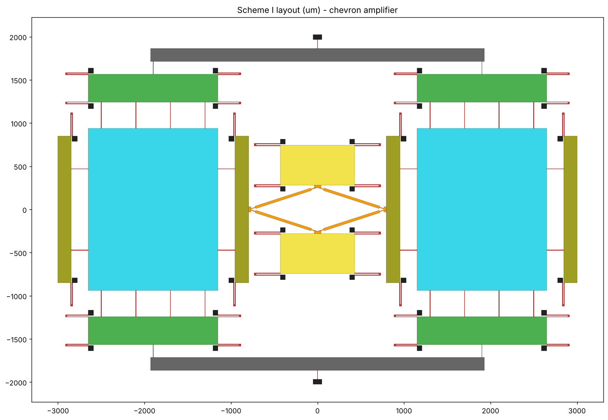
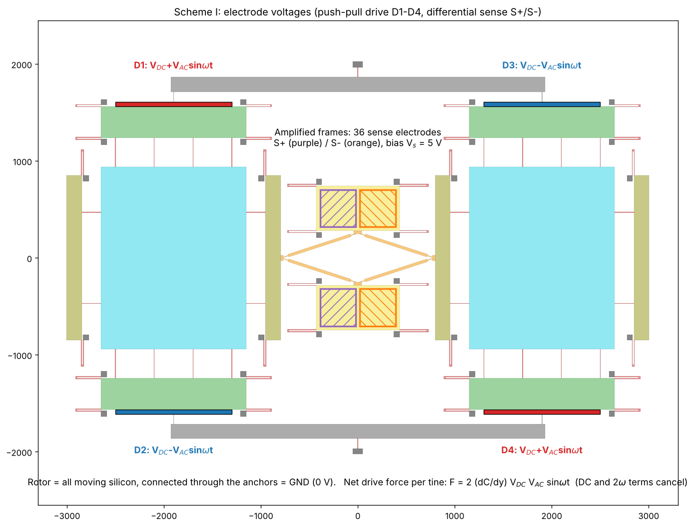
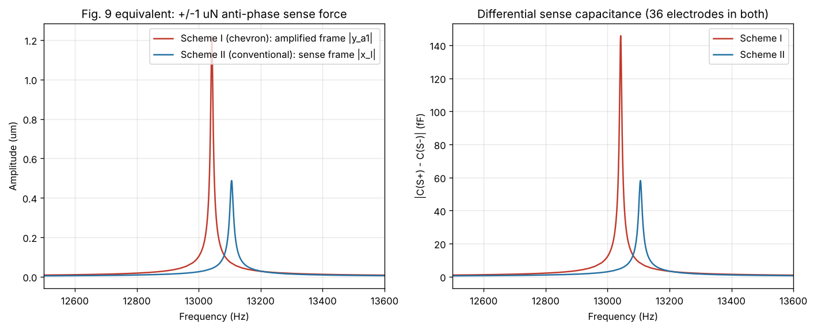

# Báo cáo sửa mô hình COMSOL — Con quay âm thoa MEMS (Scheme I Chevron vs Scheme II truyền thống)

Tài liệu tham chiếu: Hu, Calusi, Bagolini, Pantano, *Design, Analysis, and Simulation of a MEMS Tuning Fork
Gyroscope with a Mechanical Amplification Structure*, Micromachines 2025, 16, 195 (`Docs/micromachines-16-00195.pdf`).
Môi trường mô phỏng: COMSOL Multiphysics 6.3.

---

## 1. Bài báo dùng COMSOL như thế nào

| Bước | Bài báo làm gì | Thông số |
|---|---|---|
| Hình học | 3D, lớp thiết bị dày 40 µm; vẽ đầy đủ khối Coriolis, khung dẫn động, khung tách sense, lò xo gấp, đòn liên kết drive, cơ cấu chevron (Scheme I) / hình thoi có lò xo neo (Scheme II). **Răng lược điện cực bị lược bỏ** ("small comb electrodes … are omitted"). | Bảng 1: V_Coriolis = 0.1127 mm³, V_drive frame = 0.039 mm³, V_sense frame I/II = 0.0212 / 0.0402 mm³, V_khung khuếch đại = 0.032 mm³; lò xo 245/250/280/290 µm, rộng 8 µm; góc 18° (chevron), 38° (hình thoi) |
| Vật liệu | Silicon đẳng hướng, **một bộ thông số cho cả hai scheme** | Bảng 2: ρ = 2320 kg/m³, E = 170 GPa, ν = 0.22 |
| Điều kiện biên | Ngàm cố định tại các anchor; tải mô phỏng lực Coriolis | — |
| Lưới | Tứ diện, physics-controlled, tinh chỉnh ở lò xo, phần tử bậc 2 | ~410 000 / 408 000 phần tử |
| Tĩnh (5.1) | Lực 10 µN → độ cứng (Bảng 3); kiểm tra tuyến tính của chevron | độ dốc khuếch đại 1.53825 (lý thuyết 1.53884) |
| Riêng (5.2) | Tìm mode drive (ngược pha theo y) và sense (ngược pha theo x) | Bảng 4: I 12918.7 / 13043.1 Hz; II 12924.7 / 13100.6 Hz |
| Tần số (5.3) | Quét 11–15 kHz (0.1 Hz sát cộng hưởng), cặp lực **±1 µN ngược pha theo trục sense** trên hai khối Coriolis; cản nhớt từ Bảng 5 | Bảng 6: biên độ I 1.2214 µm, II 0.4833 µm → ~2.5 lần |

Điểm mấu chốt: bài báo **không** mô phỏng tĩnh điện; Hình 9 là đáp ứng cơ học dưới lực thử 1 µN. Biên độ được vẽ là
khung khuếch đại (Scheme I, theo y) và khung sense (Scheme II, theo x).

---

## 2. Kiểm toán 2 file .mph cũ (bằng chứng: `Code/verification/old_mph_audit.txt`, tái lập bằng `Code/generator/analyze_old_mph.py`)

### 2.1. Vì sao "Drive và Sense ra kết quả y hệt nhau"
* Hai plot group `pg_drive`, `pg_sense` được **gán cứng** nghiệm riêng số **10 và 11**.
* Giải mã giá trị riêng lưu trong `solution1.mphbin`:
  * File Scheme I (Figure9_Conical): 12 mode = 2286, 8027, 13499, 15614, 23066, 27287, 78399, 107656, 111449, **112103**, **115541**, 116206 Hz.
  * File Scheme II: 112000 … 273631, **274365**, **275725**, 276048 Hz.
* Như vậy "Drive" và "Sense" thực chất là hai **mode cục bộ ~112–276 kHz** (gấp 9–20 lần tần số 13 kHz), lại là cặp gần
  suy biến (bản sao trái/phải của cùng một dao động lò xo) và được chuẩn hóa "Maximum" ⇒ hình vẽ và giá trị cực đại gần như
  trùng nhau (0.0044300 vs 0.0044301 µm). Đây là lỗi lý thuyết: không có mode nào trong hai hình là mode drive/sense thật.

### 2.2. Nguyên nhân gốc: hình học sai so với bài báo
* Khối Coriolis 1200×1200 µm (0.0576 mm³ — chỉ bằng ½ Bảng 1).
* Lò xo là dầm thẳng 8×120 µm (Bảng 1: lò xo gấp 245/250/280/290 µm) ⇒ quá cứng ⇒ tần số quá cao.
* "Chevron" trong file Scheme I là các thanh suy biến chồng lên nhau ở y ≈ 0, không tạo được góc 18°.
* Ràng buộc **Roller** đặt lên toàn bộ mặt đáy (w = 0) — không có trong bài báo, cấu trúc thật treo trên đế.

### 2.3. Kết quả "Hình 9", ΔC và điện áp **không phải kết quả FEM**
* Đường cong Hình 9 là công thức gõ tay:
  `1.53825 * 2e-6 / sqrt((4598.5 - 6.84691e-7*(2*pi*freq)^2)^2 + ...)` (Scheme I = 1.53825 × đường Scheme II).
* Đồ thị ΔC = `0.70832 × (công thức trên)`; bảng ΔC 66.15 aF / 43.0 aF được điền tay.
* "Phân bố điện áp 3D" là biểu thức tô màu hình chữ nhật (25 V / −25 V / 5 V / −5 V) — **không có giao diện Electrostatics** nào trong cả hai file.

### 2.4. Tham số không đồng nhất
| Tham số | File Scheme I | File Scheme II | Bài báo (Bảng 2) |
|---|---|---|---|
| ρ | 2320 | **2330** | 2320 kg/m³ |
| ν | 0.22 | **0.28** | 0.22 |
| Cản | η = 1/1069.11 (Q lấy từ kết quả đưa ngược vào làm đầu vào) | η = 1/700.57 | cản nhớt c_d, c_s1, c_s2, c_s (Bảng 5) |
| Điện áp drive | +25 V / **−25 V** | — | push-pull V_DC ± V_AC = 25 / 15 V |
| Báo cáo docx | ν "0.28 (hoặc 0.22)", ρ "2329 (hoặc 2320)", khe "2 (hoặc 3) µm", tỉ số ΔC 1.54 ≠ tỉ số biên độ 2.53 | | |

Ghi chú về −25 V: lực tĩnh điện ∝ V², nên +25 V và −25 V **kéo như nhau** — không tạo được lực đẩy-kéo (push-pull).

---

## 3. Mô hình mới (v2)

### 3.1. Cách làm
Không có COMSOL trong môi trường này, nên hai file .mph được **sinh ra bằng mã Java API của COMSOL 6.3** (cách chuẩn để
"generate" mô hình, có thể chạy lại bất cứ lúc nào). Toàn bộ chuỗi:

```
Code/generator/tfg_geometry.py   ← nguồn hình học DUY NHẤT (tham số Bảng 1), kiểm tra chồng lấn/liên thông
Code/generator/tfg_physics.py    ← vật liệu, cản, điện cực DÙNG CHUNG cho 2 scheme
Code/generator/make_comsol_java.py → Code/comsol/TFG_SchemeI_Chevron.java, TFG_SchemeII_Conventional.java
Code/generator/fe_check.py, fe_compare.py  ← FEM độc lập (gmsh + scikit-fem) để kiểm chứng trước
```

Chạy trên máy có COMSOL 6.3: `Code/comsol/run_comsol_windows.bat` (hoặc `run_comsol_linux.sh`). Kết quả:
`MEMS_TFG_SchemeI_Chevron_v2.mph`, `MEMS_TFG_SchemeII_Conventional_v2.mph` + log, CSV, PNG, bảng so sánh.

### 3.2. Hình học (giống hệt nhau ở mọi phần, chỉ khác cơ cấu ghép sense)


| Thành phần | Kích thước | Đối chiếu Bảng 1 |
|---|---|---|
| Khối Coriolis | 1500 × 1880 × 40 µm | 0.1128 mm³ (0.1127) |
| Khung drive (2/nhánh) | 1500 × 325 µm | 0.0390 mm³ (0.0390) |
| Khung sense I / II (2/nhánh) | 156 / 296 × 1700 µm | 0.0212 / 0.0403 mm³ (0.0212 / 0.0402) |
| Khung khuếch đại (Scheme I) | 2 × 860 × 465 µm | 0.0320 mm³ (0.0320) |
| Lò xo gấp drive / sense / khung KĐ / ghép II | 245 / 250 / 280 / 290 µm, rộng 8 µm | đúng Bảng 1 |
| Góc chevron / hình thoi | 18° / 38° | đúng Bảng 1 |
| Đòn bập bênh liên kết drive | trên + dưới, trục xoay neo ở giữa | Hình 1 |

Giá trị **không có trong bài báo** được chọn để khớp tần số FEA của bài báo (Bảng 4): dầm nối khối–khung sense 197.5 µm,
dầm nối khối–khung drive 300 µm, bản lề chevron 52×8 µm, thanh hình thoi rộng 21.45 µm. Mọi primitive chỉ chạm cạnh
(không chồng lấn) ⇒ mỗi primitive = 1 domain; selection theo Box được kiểm tra là bắt đúng 1 domain.

### 3.3. Vật lý trong file .mph
* **Component 1 (3D)** – Solid Mechanics; vật liệu Bảng 2 dùng chung; Fixed tại anchor (bỏ Roller); lưới tam giác ở mặt đáy + Sweep qua chiều dày, phần tử serendipity bậc 2.
* **Cản theo Bảng 5** (không còn ép Q): cản Rayleigh tỉ lệ khối lượng (α = c/m) gắn trên từng vật cứng — khối Coriolis
  (c_s1, màng trượt), khung drive (c_d − c_s1, lược drive), khung khuếch đại (c_s2, Scheme I) hoặc khung sense (c_s − c_s1, Scheme II).
* **Component 2 (2D)** – Electrostatics: 2 ô đơn vị điện cực, nơi điện áp được đặt **thật**:
  * Ô lược drive: rotor (GND, 0 V) giữa hai nửa răng stator ở V_DC + V_AC (đỉnh = 25 V).
  * Ô tụ sense song song: rotor (GND) giữa stator A (V_s = 5 V, khe g−d) và stator B (GND, khe g+d).
  * Quét dịch chuyển rotor ±0.6 µm ⇒ C(d) ⇒ dC/dd ⇒ hệ số viền η_d, η_s được **tự động** ghi vào tham số dùng cho Component 1.
* **Các study** (tự động trong Java):
  | Study | Nội dung |
  |---|---|
  | 0 | Tĩnh điện ô đơn vị → C, dC/dx, η_d, η_s |
  | 1 | Trị riêng 24 mode quanh 12.5 kHz + **nhận dạng tự động** drive/sense |
  | 2 | Đáp ứng drive dưới lực đẩy-kéo từ điện áp |
  | 3 | Đáp ứng sense ±1 µN (Hình 9) → biên độ, Q, ΔC |
  | 4 | **Vận hành con quay**: điện áp drive + lực Coriolis −2ρΩ×v (Ω = −1…1 rad/s) tại f_drive → ΔC, V_out |
  | 5 | Tĩnh ±1 µN → k_an và hệ số khuếch đại R (mục 5.1 bài báo) |

### 3.4. Sửa lỗi "Drive = Sense": nhận dạng mode theo vật lý, không gán chỉ số cứng
Với mỗi mode, Java tính trên khối Coriolis trái/phải (giá trị trung bình u, v) và khối lượng modal:

* P_drive = |v_L − v_R| / √(∫ρ|u|²dV)  (ngược pha theo y)
* P_sense = |u_L − u_R| / √(∫ρ|u|²dV)  (ngược pha theo x)

Mode drive = mode có P_drive > P_sense và P_drive/f lớn nhất; mode sense tương tự (trọng số 1/f để loại mode cục bộ
tần số cao). Hai mode không thể trùng nhau; bảng `tbl_modes` + CSV liệt kê mọi mode với P_drive, P_sense, đồng pha/ngược pha.
Dải quét tần số Study 2–4 được đặt tự động quanh tần số tìm được.

---

## 4. Đặt điện áp tại các điện cực — đặt như thế nào và điện áp ra bao nhiêu



**Quy ước:** toàn bộ phần silicon chuyển động (rotor) nối qua anchor về **GND = 0 V**.

### 4.1. Drive: đẩy–kéo (push-pull) 4 điện cực
| Điện cực (stator) | Vị trí | Điện áp |
|---|---|---|
| D1 | lược mép ngoài khung drive trên, nhánh trái | V_DC + V_AC·sin ωt = 20 + 5 sin ωt (V) |
| D2 | lược mép ngoài khung drive dưới, nhánh trái | V_DC − V_AC·sin ωt = 20 − 5 sin ωt |
| D3 | khung drive trên, nhánh phải | V_DC − V_AC·sin ωt |
| D4 | khung drive dưới, nhánh phải | V_DC + V_AC·sin ωt |

Lực một lược: F = ½·(dC/dy)·V², dC/dy = 2·N_d·ε₀·h/g_d. Trên một nhánh, D1 kéo lên, D2 kéo xuống:

F_nhánh = ½·(dC/dy)·[(V_DC+v)² − (V_DC−v)²] = **2·(dC/dy)·V_DC·V_AC·sin ωt**

(thành phần DC và 2ω triệt tiêu ⇒ lực tuyến tính theo V_AC). Nhánh phải đảo pha AC ⇒ hai khối dao động **ngược pha**.
Số liệu (N_d = 50 ngón/lược, h = 40 µm, g_d = 3 µm, η_d = 1.011 từ Study 0):
F = 2.388 µN mỗi nhánh ⇒ biên độ drive tại cộng hưởng ≈ F/(c_d·ω) ≈ **1.13 µm**.

### 4.2. Sense: tụ vi sai S+/S− + khuếch đại điện tích
* 36 điện cực sense ở **cả hai scheme** (để so sánh công bằng — đúng như bài báo): Scheme I đặt trên 2 khung khuếch đại
  (chuyển động y), Scheme II đặt trên 4 khung sense (chuyển động x).
* Mỗi điện cực: tụ song song C₀ = ε₀·h·L/g = 9.44 fF (L = 80 µm, g = 3 µm). Nửa số điện cực có khe giảm khi dịch chuyển
  dương (nối vào S+), nửa còn lại khe tăng (nối vào S−).
* S+ và S− nối vào hai đầu vào bộ khuếch đại điện tích vi sai có điện áp chế độ chung V_s = 5 V ⇒ mỗi tụ chịu DC V_s.
* ΔC_diff = C(S+) − C(S−) = (N_s/2)·η_s·(C₀/g)·d, với d = y_T − y_B (Scheme I) hoặc x_L − x_R (Scheme II).
* Dòng i = V_s·dΔC/dt ⇒ **V_out = V_s·ΔC_diff / C_f** (biên độ tại f_drive, C_f = 100 fF), sau đó giải điều chế đồng bộ
  với tín hiệu drive ⇒ điện áp DC tỉ lệ Ω.

---

## 5. Kết quả kiểm chứng (FEM độc lập, ứng suất phẳng, phần tử P2) — số COMSOL dự kiến sai khác ≤ 1–2 %

| Đại lượng | Scheme I (mới) | Bài báo I | Scheme II (mới) | Bài báo II |
|---|---|---|---|---|
| f_drive (Hz) | **12917.0** | 12918.7 | **12980.1** | 12924.7 |
| f_sense (Hz) | **13042.4** | 13043.1 | **13106.2** | 13100.6 |
| Δf = f_s − f_d (Hz) | 125.4 | 124.4 | 126.0 | 175.9 |
| Biên độ đỉnh Hình 9 (µm) | **1.2219** | 1.2214 | **0.4872** | 0.4833 |
| Tỉ số I/II Hình 9 | **2.51×** | 2.53× | | |
| ΔC_diff đỉnh, ±1 µN (fF) | 145.7 | — | 58.1 | — |
| R (tĩnh, FEM) | 1.483 (lý thuyết 1.539) | 1.53825 | R' = 0.608 (lý thuyết 0.640) | — |
| k ngược pha (N/m) | 4484 | 4598 (k_an) | 2462 | 2480 (k'_an) |
| Q sense | 1811 | (1069)* | 1191 | (700.6)* |

Vận hành con quay (Study 4, drive bằng điện áp, Ω = 1 rad/s, tại f_drive):

| | Scheme I | Scheme II | I/II |
|---|---|---|---|
| Biên độ drive | 1.127 µm | 1.121 µm | 1.0 |
| Biên độ khung sense | 1.706 nm | 1.047 nm | 1.63 |
| ΔC_diff | 203.5 aF | 124.9 aF | 1.63 |
| V_out (charge amp) | 10.18 mV/(rad/s) = **0.178 mV/(°/s)** | 6.25 mV/(rad/s) = 0.109 mV/(°/s) | **1.63** |

Nhận xét:
1. Drive và sense nay là hai mode **khác nhau rõ rệt** (Hình `schemeI_drive_mode.png`, `schemeI_sense_mode.png`):
   drive ngược pha theo y kèm đòn bập bênh xoay; sense ngược pha theo x, khung khuếch đại dịch chuyển theo y.
   Mode đồng pha drive bị đòn liên kết đẩy lên 16.8 kHz, mode đồng pha sense ở 26.9 kHz — tách xa vùng làm việc.
2. Cải tiến của chevron tái lập đúng bài báo: **2.51×** biên độ và ΔC tại cộng hưởng sense (Hình 9).
3. Khi vận hành thật (drive tại f_drive, lệch tần ~125 Hz như nhau ở hai scheme) lợi ích là **1.63×**: lệch tần làm
   đáp ứng sense bị chi phối bởi độ cứng, mà chevron cũng làm tăng độ cứng ngược pha (k_an 4484 vs 2462 N/m). Khi khớp mode
   (điều chỉnh tĩnh điện như mục 5.5 bài báo) lợi ích tiến về ~2.5×.
4. (*) Q do bài báo báo cáo (1069/700) không nhất quán với chính Bảng 5 của bài báo; mô hình mới dùng hệ số cản Bảng 5 và
   tái lập đúng biên độ Bảng 6 (biên độ = F/(c·ω) không phụ thuộc cách định nghĩa Q).



Hội tụ lưới (FEM kiểm chứng, lưới mịn gấp ~1.8 lần): sai khác tần số ≤ 0.4 % (≤ 52 Hz); Δf đổi 10 Hz (I) và
33 Hz (II). Vì Δf nhạy với lưới, kết quả vận hành con quay (mục Study 4) trong COMSOL nên đọc kèm Δf thực tế in trong log.

---

## 6. Kiểm tra để tránh sai sót (đã làm)
* Hình học: tự động kiểm tra không chồng lấn, liên thông, mỗi Box-selection bắt đúng 1 domain, khe hở ≥ 5 µm
  (đã bắt được và sửa một lỗi chồng lấn bản lề hình thoi).
* Thể tích các khối khớp Bảng 1 (sai khác ≤ 0.2 %).
* Mã Java được **biên dịch** và **chạy khô toàn bộ** (stub API có kiểm tra: mọi tag/selection/dataset tham chiếu phải tồn tại,
  feature bị tắt trong study phải tồn tại).
* Tên thuộc tính COMSOL 6.3 đối chiếu với XML của chính 2 file .mph cũ (BodyLoad `forceReferenceVolume`, Damping
  `alpha_dM`/`beta_dK`, Eigenfrequency `neigs`/`shift`…).
* Java tự bảo vệ: lỗi ở bước nào được ghi vào `*_log.txt`, mô hình vẫn được lưu; nếu Study 0 lỗi thì giữ η = 1.
* FEM độc lập dùng cùng file hình học và cùng tiêu chí nhận dạng mode như Java.

## 7. Giới hạn cần biết
* Các file .mph v2 phải được sinh trên máy có COMSOL 6.3 (môi trường hiện tại không có COMSOL/giấy phép). Thời gian ước
  tính: vài chục phút đến 1–2 giờ (lưới mức 2; `TFG_MESH=1` để chạy nhanh, `TFG_PAPER=1` để quét 0.1 Hz như bài báo).
* Hình học là bản dựng lại theo Bảng 1 và Hình 1 (bài báo không công bố bản vẽ chi tiết); răng lược điện cực được
  mô hình hóa tập trung (như bài báo) + ô tĩnh điện 2D.
* COMSOL 3D có thể lệch FEM ứng suất phẳng ~1–2 %; vì mode và dải quét được xác định tự động, các kết quả vẫn nhất quán.

---

## 8. Kết quả chạy COMSOL 6.3 thực tế và sửa lỗi hình ảnh chuyển động (cập nhật)

### 8.1. Kết quả COMSOL khớp dự đoán
| | Scheme I (COMSOL) | dự đoán FEM 2D | Scheme II (COMSOL) | dự đoán FEM 2D |
|---|---|---|---|---|
| f_drive (Hz) | 12929.2 | 12917.0 | 12985.7 | 12980.1 |
| f_sense (Hz) | 13080.9 | 13042.4 | 13116.4 | 13106.2 |
| Biên độ Hình 9 (µm) | 1.2182 | 1.2219 | 0.4868 | 0.4872 |
| Tỉ số I/II | **2.50×** | 2.51× | | |
| R (tĩnh) | 1.483 | 1.483 | 0.608 | 0.608 |

Trong bảng mode, drive = mode 1 và sense = mode 2 có P_drive / P_sense ≈ 2.3·10³. Các mode 4–7, 9–16… có
P ≈ 10⁻⁶–10⁻⁵ là mode **uốn ngoài mặt phẳng (z)** ở 18–45 kHz. Chúng không phải mode làm việc.

### 8.2. Vì sao ảnh động "cảm biến bị biến dạng theo z"
Ảnh động `*_sense_mode.gif` cũ được xuất bằng nút Animation với chuỗi khung mặc định **"Stored solutions"**
(giá trị `sweeptype = "dynamic"` không hợp lệ nên COMSOL giữ mặc định). Vì vậy GIF **duyệt qua lần lượt 24 mode riêng**
chứ không cho một mode dao động:
* khung 0 = mode 1 (drive), dù tiêu đề ghi "Sense mode #2";
* khung 1 = mode 2 (sense, đúng);
* khung 3 = mode 4 (18.2 kHz, khối Coriolis và khung uốn theo z), v.v.

Bản thân mode drive/sense **nằm trong mặt phẳng**. Biến dạng z chỉ đến từ các mode khác bị ghép vào GIF.

### 8.3. Đã sửa
* Animation dùng **Dynamic data extension** (`sweeptype = "dde"`, chu kỳ đầy đủ). Ảnh động là u(t) = Re(U·e^{iφ}),
  φ = 0…360°, của **đúng một mode** (mode đặt trong plot group).
* **Hệ số biến dạng cố định** (150 µm / max|u| của mode) cho mọi khung, nên biên độ không bị co giãn giữa các khung.
* Phương án dự phòng: xuất 12 khung PNG theo pha (`*_phase000.png … *_phase330.png`), ghép bằng
  `python Code/generator/make_mode_gifs.py Code/comsol`.
* Thêm chỉ số **z_frac** = ‖w‖/‖u‖ cho mỗi mode vào bảng mode / log / CSV. Mode có z_frac > 0.3 không được chọn làm drive/sense.
* Lỗi khác trong log: Study 0 chọn nhầm dataset của quét tham số (dC/dy = NaN, η giữ = 1). Nay chọn dataset chứa
  nhiều nghiệm nhất. `comp1.F_drive` đổi thành `F_drive` (tham số toàn cục). Thư mục xuất được ghi vào Java
  (`--outdir`) vì comsolbatch chặn `System.getenv` và không chạy trong thư mục chứa file java.

### 8.4. Xuất lại ảnh động mà không phải giải lại
```
comsolcompile ExportMissingVisuals.java
comsolbatch -inputfile ExportMissingVisuals.class -nosave
python ..\generator\make_mode_gifs.py .
```
`ExportMissingVisuals.java` mở 2 file .mph đã giải, đặt hệ số biến dạng cố định, xuất GIF quét pha và 12 khung PNG.
Các ảnh động trong `Bao_Cao_Chuong_5_*.docx` cần thay bằng ảnh mới.
